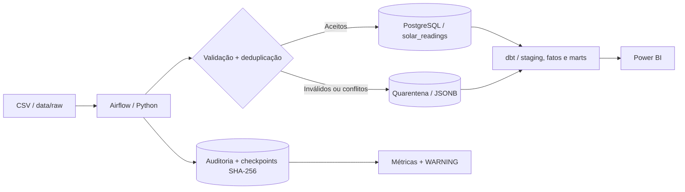

# Solar Data Platform

[](https://github.com/DanielMartinez2/solar-data-platform/actions/workflows/ci.yml)

**Pipeline de Engenharia de Dados de ponta a ponta para medições fotovoltaicas sintéticas**, construído com Python, PostgreSQL, dbt, Apache Airflow, Docker e Power BI.

O projeto demonstra ingestão incremental, validação, quarentena, cargas idempotentes, controle de alterações de arquivos, modelagem analítica, observabilidade, testes e recuperação de falhas. Os dados utilizados são **sintéticos**; este é um ambiente de aprendizagem/portfólio e não um sistema de monitoramento solar em produção.

## Arquitetura



A DAG **`solar_ingestion_pipeline`** executa diariamente às **09:00 (America/Sao_Paulo)**, com a seguinte ordem:

```text
run_migrations  ->  ingest_raw_csv  ->  dbt_build
```

O Airflow orquestra o processo, enquanto regras de validação, persistência, controles de arquivo e transformações permanecem em módulos independentes. Veja a [arquitetura técnica detalhada](docs/architecture.md).

## Principais decisões de engenharia

| Recurso | Como funciona |
|---|---|
| Validação de medições | Cabeçalhos, timestamps, tipos, domínios, duplicatas exatas e conflitos de chave natural |
| Chave de negócio | `(timestamp, site_id, panel_id)` |
| Quarentena | Registros problemáticos com origem e erros em PostgreSQL JSONB |
| Persistência | PostgreSQL **COPY** + staging temporária + `ON CONFLICT DO NOTHING` |
| Ingestão incremental | Descoberta ordenada de `data/raw/*.csv`; checkpoint por **nome + SHA-256** |
| Arquivos alterados | Mesmo nome com conteúdo diferente provoca falha; fontes devem ser imutáveis |
| Auditoria | `ingestion_runs` e `processed_files` ligados a cada execução |
| Qualidade operacional | View `vw_ingestion_batch_quality` e warnings de quarentena, duplicação ou lote vazio |
| Transformação | dbt Core: staging, dimensão, fatos, marts e testes automatizados |
| Resiliência | Retries, limites de execução, `max_active_runs=1`, logs estruturados e exercícios isolados |
| CI | GitHub Actions executa testes Python e validação dbt |

**Qualidade não bloqueante:** por padrão, quarentena acima de **20%**, duplicatas acima de **10%** e lote vazio geram `WARNING`, não interrompem a pipeline. Erros técnicos e testes dbt que falham continuam encerrando a task com erro.

## Resultado analítico

A plataforma transforma medições válidas em indicadores por painel, instalação e período:

- Potência instantânea calculada como `power_w = voltage_v × current_a`.
- Séries de potência horária e diária.
- Cobertura diária de medições válidas em relação às medições esperadas.
- Decomposição de perdas por lacunas, valores inválidos e conflitos.
- Classificação de erros presentes na quarentena.

O dashboard **Power BI** é organizado em quatro visões: **Individual**, **Comparação entre instalações**, **Qualidade** e **Quarentena**.

**Limite de interpretação:** cobertura mede completude de registros, não disponibilidade física de equipamentos. Potência medida não equivale a energia produzida em kWh e a simulação não representa previsão fotovoltaica real.

## Dados de demonstração e desempenho

O cenário sintético principal documentado no projeto usa 30 dias, 10 instalações, 10 painéis por instalação e intervalos de 15 minutos, com **288.000 medições esperadas**.

| Indicador do cenário sintético | Valor |
|---|---:|
| Medições aceitas | 283.392 |
| Medições esperadas | 288.000 |
| Cobertura geral | 98,40% |
| Registros colocados em quarentena | 2.016 |
| Duplicatas exatas descartadas | 1.440 |

Em benchmark local documentado, a mediana da **persistência** de leituras válidas caiu de **33,529 s** (`executemany`) para **7,335 s** (PostgreSQL `COPY` + staging temporária): aproximadamente **4,57×** de aceleração nessa etapa. Considerando o fluxo completo medido naquele benchmark, as medianas foram 38,380 s e 11,766 s, respectivamente. Esses tempos são observações do ambiente de desenvolvimento, **não garantias de desempenho em produção**.

O gerador aceita parâmetros para lacunas, duplicatas, valores inválidos, conflitos e semente aleatória. Consulte [geração dos dados](docs/README_GENERATOR.md) e [modelagem do warehouse](docs/data_warehouse.md).

## Quick start — Windows / PowerShell

Requisitos: **Python 3.12+**, **Docker Desktop com Compose** e, opcionalmente, **Power BI Desktop**.

```powershell
git clone https://github.com/DanielMartinez2/solar-data-platform.git
cd solar-data-platform
python -m venv .venv
.\.venv\Scripts\Activate.ps1
python -m pip install -r requirements.txt

# Execute a cópia apenas na primeira configuração:
Copy-Item .env.example .env
# Ajuste as credenciais no .env sem versioná-lo.

docker compose up -d postgres postgres_test
python scripts/run_migrations.py
python scripts/run_migrations.py --database-url-env TEST_DATABASE_URL
python -m pytest -q
```

**Ingestão local incremental:**

```powershell
python -m scripts.ingest_raw_batches
```

**Criar/validar o warehouse:**

```powershell
python scripts/run_dbt.py build
```

**Subir Airflow (opcional, perfil separado):**

```powershell
docker compose --profile airflow build
docker compose --profile airflow up airflow-init
docker compose --profile airflow up -d
```

Acesse **<http://localhost:8080>**, habilite a DAG `solar_ingestion_pipeline` se estiver pausada e execute manualmente para conferir `run_migrations → ingest_raw_csv → dbt_build`.

O `.env.example` contém valores **somente para estudo local**. Não use essas senhas e essa configuração de autenticação Airflow em ambiente público ou de produção.

Para copiar dados gerados para `data/raw`, gerenciar checkpoints, verificar migrações, conectar o Power BI e diagnosticar falhas, siga o [guia completo de desenvolvimento local](docs/local_development.md).

## Estrutura do repositório

```text
solar-data-platform/
├── .github/workflows/ci.yml        # Testes automatizados
├── airflow/dags/                   # Pipeline e DAGs de exercícios isolados
├── data/raw/                       # Entradas CSV imutáveis
├── data/generated/                 # Dados sintéticos geráveis localmente
├── database/migrations/            # Evolução versionada de schema
├── docs/                           # Arquitetura, operação e experimentos
├── scripts/                        # Migrations, ingestão em lotes e utilitários
├── src/                            # Validação, persistência e alertas de qualidade
├── tests/                          # Testes Python unitários/integrados
├── warehouse/                      # dbt: staging, marts, seeds e testes
├── compose.yaml
├── pytest.ini
└── requirements.txt
```

## Testes de resiliência realizados

A infraestrutura foi exercitada com DAGs **manuais e isoladas** que não alteram o pipeline analítico principal:

| Experimento | Resultado observado |
|---|---|
| PostgreSQL de testes temporariamente indisponível | Falha, retry e sucesso após restauração |
| dbt com teste singular propositalmente inválido | Erro propagado ao Airflow; nova execução passa com condição corrigida |
| Timeout controlado | Task longa termina em erro; execução curta passa |
| Concorrência | Duas execuções da mesma DAG não ficam ativas simultaneamente com `max_active_runs=1` |

Os exercícios documentam comportamentos no ambiente local, não substituem avaliações de disponibilidade, segurança ou escalabilidade em produção.

## Documentação

- [Arquitetura, fluxos e contratos técnicos](docs/architecture.md)
- [Instalação, execução, testes e diagnóstico](docs/local_development.md)
- [Indicadores operacionais por lote e consulta SQL](docs/batch_quality_metrics.md)
- [Modelo analítico e interpretação das métricas](docs/data_warehouse.md)
- [Gerador de dados sintéticos](docs/README_GENERATOR.md)
- [Drill: recuperação PostgreSQL de testes](docs/postgres_recovery_drill.md)
- [Drill: falha de qualidade dbt](docs/dbt_quality_failure_drill.md)
- [Drill: timeouts e concorrência](docs/airflow_timeout_concurrency_drill.md)

## Limitações e próximos passos

O projeto é local, baseado em arquivos CSV e dados sintéticos. Não inclui ingestão de dispositivos reais, implantação em nuvem, notificações externas ou previsão energética. Os marts já incluem **cobertura diária e lacunas**, mas alertas automáticos de atraso/ausência temporal de lotes ainda podem ser desenvolvidos como evolução futura.

O foco desta versão é demonstrar **boas práticas de Engenharia de Dados reproduzíveis e verificáveis**, com separação de responsabilidades, qualidade, rastreabilidade e automação.
