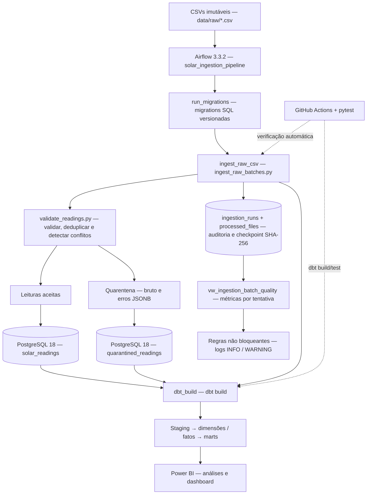

# Solar Data Platform — arquitetura técnica

> Projeto educacional e de portfólio com dados fotovoltaicos sintéticos. A configuração atual é para desenvolvimento local e **não** constitui um serviço de produção.

## Visão de ponta a ponta

**A ordem real de execução da DAG é** `run_migrations >> ingest_raw_csv >> dbt_build`. O diagrama detalha as responsabilidades internas de cada etapa; não representa várias tasks Airflow adicionais.

## Contratos e decisões de engenharia

| Componente | Contrato ou responsabilidade | Implementação |
|---|---|---|
| CSV | Nome imutável; arquivos `*.csv` diretamente em `data/raw`; ordem alfabética | `scripts/ingest_raw_batches.py` |
| Validação | Cabeçalho, timestamps, tipos, domínio, duplicatas exatas, conflitos da mesma chave | `src/validate_readings.py` |
| Chave natural | `(timestamp, site_id, panel_id)` | `src/database.py` e schema |
| Quarentena | Preserva origem, linha, valores brutos e motivos em JSONB | `quarantined_readings` |
| Persistência | PostgreSQL COPY em staging temporária, deduplicação e `ON CONFLICT DO NOTHING` | `src/database.py` |
| Checkpoint | SHA-256 por arquivo + auditoria da tentativa na mesma transação das leituras e quarentena | `processed_files`, `ingestion_runs` |
| Concorrência da ingestão | Advisory lock por nome do arquivo durante a transação | `ingest_csv_incremental` |
| Migrações | Arquivos versionados e checksum verificado; não editar migration já aplicada | `scripts/run_migrations.py` |
| Métricas | Taxas de quarentena, duplicação e inserção, por tentativa de ingestão | `vw_ingestion_batch_quality` |
| Avisos | Quarentena >20%, duplicatas >10%, lote vazio; aviso **não bloqueia** dbt | `src/batch_quality_rules.py` |
| Transformação | Camadas staging, dimensão, fatos e marts; testes dbt | `warehouse/` |
| Orquestração | Daily 09:00 `America/Sao_Paulo`, sem catchup, 1 DAG run ativa | `airflow/dags/solar_ingestion_pipeline.py` |

### O que acontece ao repetir um arquivo?

1. Arquivo novo → cria auditoria; valida, persiste e registra checkpoint.
2. Mesmo nome, mesmo SHA-256 → skip; não duplica leituras, não cria outra ingestão bem-sucedida nem reemite avisos para o lote.
3. Mesmo nome, SHA-256 diferente → falha explícita: arquivos de entrada precisam de **nome único e conteúdo imutável**.
4. Falha antes do commit → rollback de leituras/quarentena/checkpoint; auditoria de falha é registrada separadamente quando a tentativa já existe.

O checkpoint impede reprocessamento físico do **arquivo**, enquanto a chave natural e o `ON CONFLICT` garantem idempotência também quando arquivos distintos contêm medições sobrepostas.

### Métricas operacionais

`quarantine_rate_pct = 100 × quarantined / (accepted + quarantined)`

`duplicate_rate_pct = 100 × duplicates / (accepted + quarantined + duplicates)`

`insertion_rate_pct = 100 × inserted_readings / accepted`

As taxas usam 2 casas decimais e retornam `NULL` quando o denominador é zero. Tentativas falhas ou incompletas não apresentam percentuais artificiais. A taxa de inserção mede novidade no banco, **não** confiabilidade das medições.

Consulte [indicadores e SQL de diagnóstico](batch_quality_metrics.md).

## Separação de ambientes

- `postgres` → banco de **desenvolvimento** das medições e warehouse (PostgreSQL 18).
- `postgres_test` → banco de testes automatizados e exercícios isolados (PostgreSQL 18).
- `airflow-postgres` → exclusivamente os metadados do orquestrador (PostgreSQL 17).

Dentro de containers, endereços usam os **nomes dos serviços Docker** e porta 5432. No Windows, o ambiente de desenvolvimento usa `localhost:5433` e testes `localhost:5434`, salvo configuração distinta em `.env`.

## Camada analítica

O `warehouse/` usa um profile `solar_warehouse`, com modelos de staging, dimensão/fatos e marts por instalação e período. `power_w = voltage_v × current_a`. O cálculo de cobertura compara medições válidas com medições esperadas conforme o seed de configuração por instalação.

Cobertura não equivale a disponibilidade física, potência observada pode subestimar potência total quando há painéis sem medições, e médias de potência **não** correspondem a energia produzida em kWh. Ver [detalhes do data warehouse](data_warehouse.md).

## Resiliência e escopo validado

Pipeline: `retries=2` por task, `retry_delay=30s`, timeout de 2/5/10 min para migrations/ingestão/dbt, respectivamente, `max_active_runs=1` e `dagrun_timeout=20 min`. O código retransmite níveis de log estruturados de subprocessos ao Airflow.

Cenários manuais, independentes da pipeline de dados:
- Indisponibilidade e retorno do PostgreSQL de **testes**, com retry ([guia](postgres_recovery_drill.md)).
- Falha determinística de teste dbt e nova execução após correção explícita ([guia](dbt_quality_failure_drill.md)).
- Timeout curto e duas DAG runs concorrentes com `max_active_runs=1` ([guia](airflow_timeout_concurrency_drill.md)).

Testes manuais comprovam os comportamentos desses exercícios no ambiente local, não uma garantia de disponibilidade de produção.

## Limitações declaradas

- Dados sintéticos e modelo fotovoltaico simplificado, não leituras reais nem previsão de geração.
- Execução local em Docker Compose; não há implantação cloud, orquestração distribuída, integração com API externa ou alertas por e-mail no escopo atual.
- Regras operacionais geram `WARNING`; **não** fazem bloqueio por limiar.
- Sem monitoramento automático de lacunas temporais no nível do arquivo de ingestão. Existem métricas analíticas de **cobertura** e **lacunas** nos marts dbt, que não devem ser confundidas com alertas operacionais de chegada atrasada.
- A conexão do Power BI e o arquivo local do relatório podem exigir configuração própria; o banco e os modelos são os produtos analíticos reproduzíveis pelo código.

Veja [guia de execução e manutenção](local_development.md).
